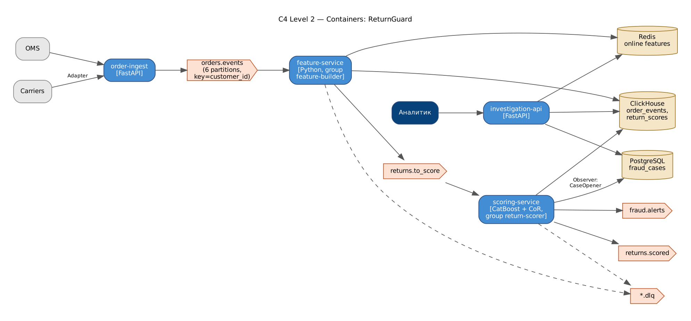

# ReturnGuard — антифрод возвратов в e-commerce

Потоковая система, которая находит клиентов, систематически злоупотребляющих возвратами
(wardrobing, ложные «не получил», «повреждено», перекупщики), по истории заказов, товаров и доставки.

**Стек:** Python · Kafka · CatBoost · ClickHouse · PostgreSQL · Redis · FastAPI · Docker



## Архитектура

`order-ingest` → **orders.events** → `feature-service` (Redis, ClickHouse) → **returns.to_score** →
`scoring-service` (Chain of Responsibility + CatBoost) → **returns.scored** / **fraud.alerts** / кейсы в PostgreSQL →
`investigation-api` (FastAPI).

| Топик | Партиции | Ключ | Producer | Consumer group |
|---|---|---|---|---|
| orders.events | 6 | customer_id | order-ingest | feature-builder |
| returns.to_score | 6 | customer_id | feature-service | return-scorer |
| returns.scored | 6 | customer_id | scoring-service | OMS / аналитика |
| fraud.alerts | 3 | customer_id | scoring-service | антифрод-команда |
| *.dlq | 1 | — | consumer'ы | ручной разбор |

Паттерны: **Strategy** (стратегии скоринга), **Chain of Responsibility** (allowlist → жёсткие правила → velocity → модель → пороги),
**Observer** (кейсы/алерты/метрики), **Repository** (Redis/ClickHouse/PostgreSQL), **Adapter** (вебхуки служб доставки, Kafka).

## Результаты (out-of-time тест)

| Модель | ROC-AUC | PR-AUC | Recall @ FPR 1% |
|---|---|---|---|
| Правила (baseline) | 0.781 | 0.306 | 0.089 |
| Logistic Regression | 0.984 | 0.869 | 0.563 |
| **CatBoost** | **0.993** | **0.946** | **0.826** |

Сквозной прогон на новой популяции клиентов: ROC-AUC 0.9774, перехвачено 92.9% суммы
мошеннических возвратов; задержка скоринга p95 = 7.92 мс.

> Данные синтетические (поведенческий симулятор `returnguard/datagen.py`): реальные данные о мошенничестве закрыты.

## Запуск

```bash
# полный стек
docker compose up -d --build
docker compose --profile demo run --rm replay        # залить синтетический поток
# Swagger: http://localhost:8000/docs  (X-API-Token: dev-token),  Kafka UI: http://localhost:8080

# локально
pip install -r requirements.txt
python -m returnguard.train            # обучение + метрики + графики (docs/img)
python scripts/run_pipeline_demo.py    # сквозной прогон пайплайна
pytest -q
```

## API

| Метод | Путь | Описание |
|---|---|---|
| POST | /v1/score | синхронный скоринг возврата |
| GET | /v1/customers/{id}/risk | профиль риска + SHAP-объяснение |
| GET | /v1/customers/{id}/timeline | история событий |
| GET | /v1/cases?status=open | очередь кейсов |
| POST | /v1/cases/{id}/decision | вердикт аналитика |
| GET | /v1/analytics/daily | дневная сводка |
| POST | /v1/events, /v1/carriers/{carrier} | ingest (order-ingest) |


## Демонстрация: Docker, e2e-тесты, нагрузка, Grafana

```powershell
docker compose build                                               # один раз
powershell -ExecutionPolicy Bypass -File scripts\demo.ps1 -SkipBuild  # Linux/macOS: ./scripts/demo.sh
```

Скрипт поднимает стек, ждёт healthcheck, сохраняет в `evidence/` список контейнеров, состав docker-сети,
топики Kafka, запускает **e2e-тесты из контейнера внутри сети** (`docker compose --profile e2e run --rm e2e`),
**нагрузочный тест k6** (`docker compose --profile load run --rm k6`) с выводом метрик в Prometheus,
снимает `docker stats` во время нагрузки, lag consumer groups и логи.

* Grafana: http://localhost:3000 — дашборд «overview»: k6 (RPS, латентность, ошибки) → API (RPS по эндпоинтам, p50/p95/p99, 4xx/5xx)
  → Kafka (поток по топикам, обработка по consumer group, **consumer lag**, время обработки, ретраи/DLQ, реплики воркеров) → доменные метрики → **аналитика ClickHouse** (решения по дням, топ рисковых клиентов, разбор JSON событий).
* Prometheus: http://localhost:9090

Подробная инструкция с установкой Docker Desktop и записью видео — в `ДЕМО_ИНСТРУКЦИЯ.md` (корень архива).

## Автор

Царьков Артём — проект выполнен индивидуально (архитектура, код, обучение моделей, тесты, отчёт).
Отчёт по проекту (Word/PDF) — в папке [`report/`](report/).
