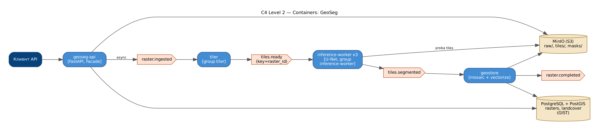
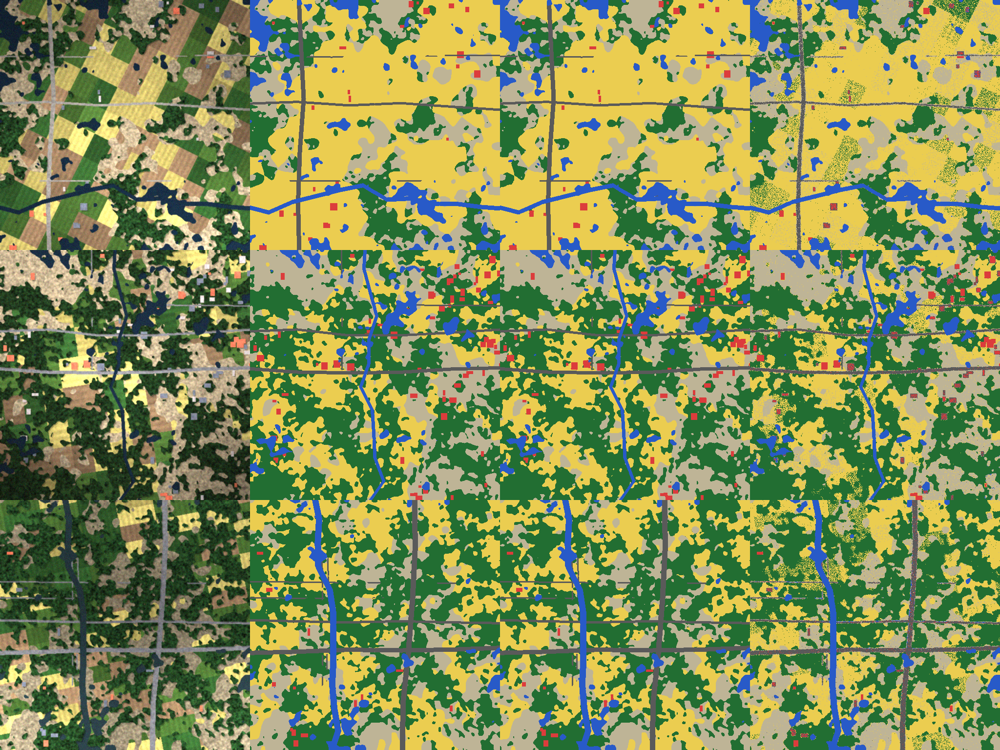

# GeoSeg — сегментация спутниковых снимков

Разделяет многоспектральный снимок (R, G, B, NIR) на **лес, воду, здания, дороги, сельхозугодья** (и «прочее»),
векторизует результат и сохраняет полигоны в PostGIS для геоаналитики.

**Стек:** Python · PyTorch (U-Net) · Rasterio · S3 (SeaweedFS, клиент MinIO) · FastAPI · PostgreSQL/PostGIS · Kafka · Docker



Конвейер: **Raster ingestion → tiling → segmentation inference → mosaic → vectorize → geospatial storage → API**.

| Топик | Ключ | Producer → Consumer group |
|---|---|---|
| raster.ingested | raster_id | api → tiler |
| tiles.ready | raster_id | tiler → inference-worker (×3) |
| tiles.segmented | raster_id | inference-worker → geostore |
| raster.completed | raster_id | geostore → подписчики |

Паттерны: **Pipeline** (стадии конвейера), **Facade** (`LandCoverFacade`), **Strategy** (U-Net / SegFormer / baseline'ы),
**Adapter** (S3 ↔ локальная ФС, SegFormer ↔ общий интерфейс), **Repository** (PostGIS / SQLite).

## Результаты (12 тестовых сцен 512×512)

| Модель | mIoU | Pixel acc. | IoU здания | IoU дороги |
|---|---|---|---|---|
| Спектральные индексы (NDVI/NDWI, baseline) | 0.308 | 0.448 | 0.045 | 0.074 |
| Random Forest по пикселю (baseline) | 0.798 | 0.913 | 0.647 | 0.641 |
| **U-Net (1.9M параметров)** | **0.987** | **0.994** | **0.981** | **0.984** |


*Снимок · разметка · U-Net · Random Forest*

> Датасет процедурный (`geoseg/synth.py`) — GeoTIFF с CRS EPSG:32637 и реалистичными спектральными сигнатурами;
> для реальных данных (LandCover.ai, DeepGlobe) достаточно положить GeoTIFF+маски в `data/`.

## Запуск

```bash
docker compose up -d --build
curl -F file=@scene.tif "http://localhost:8000/v1/rasters?mode=async"   # или mode=sync
# Swagger: http://localhost:8000/docs, S3 API: http://localhost:9000 (SeaweedFS)

pip install -r requirements.txt
python -m geoseg.synth          # сгенерировать датасет
python -m geoseg.train          # обучить U-Net и baseline'ы
pytest -q
```

## API

| Метод | Путь | Описание |
|---|---|---|
| POST | /v1/rasters?mode=sync\|async | загрузка GeoTIFF |
| GET | /v1/rasters/{id} | статус, площади классов, тайминги стадий |
| GET | /v1/rasters/{id}/mask.png | цветная маска |
| GET | /v1/rasters/{id}/stats | площади классов (га) |
| GET | /v1/landcover?bbox=&cls= | GeoJSON полигонов |


## Демонстрация: Docker, e2e-тесты, нагрузка, Grafana

```powershell
docker compose build                                               # один раз
powershell -ExecutionPolicy Bypass -File scripts\demo.ps1 -SkipBuild  # Linux/macOS: ./scripts/demo.sh
```

Скрипт поднимает стек, ждёт healthcheck, сохраняет в `evidence/` список контейнеров, состав docker-сети,
топики Kafka, запускает **e2e-тесты из контейнера внутри сети** (`docker compose --profile e2e run --rm e2e`),
**нагрузочный тест k6** (`docker compose --profile load run --rm k6`) с выводом метрик в Prometheus,
снимает `docker stats` во время нагрузки, lag consumer groups и логи.

* Grafana: http://localhost:3000 — дашборд «overview»: k6 (RPS, латентность, ошибки) → API (RPS по эндпоинтам, p50/p95/p99, 4xx/5xx)
  → Kafka (поток по топикам, обработка по consumer group, **consumer lag**, время обработки, ретраи/DLQ, реплики воркеров) → доменные метрики.
* Prometheus: http://localhost:9090

Подробная инструкция с установкой Docker Desktop и записью видео — в `ДЕМО_ИНСТРУКЦИЯ.md` (корень архива).

## Автор

Царьков Артём — проект выполнен индивидуально (архитектура, код, обучение моделей, тесты, отчёт).
Отчёт по проекту (Word/PDF) — в папке [`report/`](report/).
