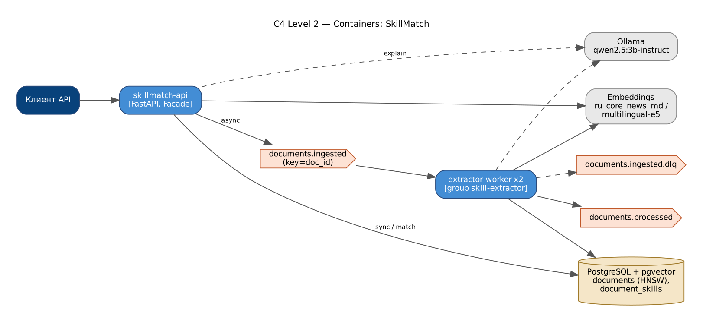

# SkillMatch — LLM-анализ резюме и вакансий

Извлекает навыки из резюме и вакансий, сопоставляет их и объясняет, каких компетенций кандидату не хватает.

**Стек:** Python · FastAPI · LLM (Ollama / OpenAI-compatible, Hugging Face) · embeddings (spaCy ru_core_news_md / multilingual-e5) · pgvector · Kafka · PostgreSQL · Docker



Конвейер документа: **parse (txt/pdf/docx) → title split → skill extraction → must/nice split → embedding → pgvector**.
Сопоставление: exact / related (таксономия) / semantic (эмбеддинги) → скор, пробелы, объяснение.
Контроль галлюцинаций: LLM-навыки валидируются по таксономии, evidence проверяется в тексте,
объяснение LLM отклоняется (fallback на шаблон), если упоминает навык вне фактов.

Паттерны: **Facade** (`SkillMatchFacade`), **Strategy** (экстракторы, эмбеддеры, объяснители), **Adapter** (LLM-провайдеры, парсеры форматов),
**Repository** (pgvector / in-memory), **Pipeline** (`DocumentPipeline`).

## Результаты (600 резюме × 60 вакансий)

| Извлечение навыков | Precision | Recall | F1 |
|---|---|---|---|
| Словарь синонимов + морфология | 1.000 | 0.927 | 0.962 |
| Гибрид (+ семантический поиск неявных навыков) | 0.970 | 0.942 | 0.956 |

| Ранжирование кандидатов | ROC-AUC | NDCG@10 | P@10 |
|---|---|---|---|
| tfidf_cosine (baseline) | 0.926 | 0.520 | 0.500 |
| embedding_cosine (spaCy) | 0.545 | 0.103 | 0.100 |
| skill_matcher: exact only (ablation) | 0.997 | 1.000 | 1.000 |
| skill_matcher: exact+related+semantic (default) | 0.992 | 0.961 | 0.950 |
| skill_matcher on gold skills (upper bound) | 0.995 | 0.989 | 0.983 |

Полнота кандидатогенерации (top-50): 0.966; поиск пробелов: F1 = 0.945.

## Запуск

```bash
docker compose up -d --build       # api, extractor-worker, kafka, postgres+pgvector, ollama (qwen2.5:3b-instruct)
# Swagger: http://localhost:8000/docs

pip install -r requirements.txt
python scripts/evaluate.py         # метрики и графики
pytest -q
```

## API

| Метод | Путь | Описание |
|---|---|---|
| POST | /v1/documents?mode=sync\|async | резюме / вакансия (текст) |
| POST | /v1/documents/upload | файл txt/pdf/docx |
| GET | /v1/documents/{id} | навыки с evidence |
| POST | /v1/match | сопоставление + объяснение пробелов |
| GET | /v1/vacancies/{id}/candidates | лучшие кандидаты |


## Демонстрация: Docker, e2e-тесты, нагрузка, Grafana

```powershell
docker compose build                                               # один раз
powershell -ExecutionPolicy Bypass -File scripts\demo.ps1 -SkipBuild  # Linux/macOS: ./scripts/demo.sh
```

Скрипт поднимает стек, ждёт healthcheck, сохраняет в `evidence/` список контейнеров, состав docker-сети,
топики Kafka, запускает **e2e-тесты из контейнера внутри сети** (`docker compose --profile e2e run --rm e2e`),
**нагрузочный тест k6** (`docker compose --profile load run --rm k6`) с выводом метрик в Prometheus,
снимает `docker stats` во время нагрузки, lag consumer groups и логи.

* Grafana: http://localhost:3000 — дашборд «overview»: k6 (RPS, латентность, ошибки) → API (RPS по эндпоинтам, p50/p95/p99, 4xx/5xx)
  → Kafka (поток по топикам, обработка по consumer group, **consumer lag**, время обработки, ретраи/DLQ, реплики воркеров) → доменные метрики.
* Prometheus: http://localhost:9090

Подробная инструкция с установкой Docker Desktop и записью видео — в `ДЕМО_ИНСТРУКЦИЯ.md` (корень архива).

## Автор

Царьков Артём — проект выполнен индивидуально (архитектура, код, обучение моделей, тесты, отчёт).
Отчёт по проекту (Word/PDF) — в папке [`report/`](report/).
