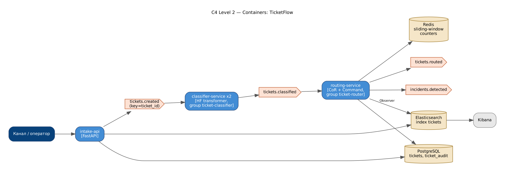

# TicketFlow — классификация и маршрутизация обращений в поддержку

Автоматически определяет **категорию**, **приоритет** и **маршрут** тикета между командами;
поиск похожих обращений и аналитика в Elasticsearch.

**Стек:** Python · Kafka · Hugging Face transformers · FastAPI · PostgreSQL · Redis · Elasticsearch · Docker



`intake-api` → **tickets.created** → `classifier-service` (HF-модель + ключевые слова) → **tickets.classified** →
`routing-service` (Chain of Responsibility + Command) → **tickets.routed** / **incidents.detected**; PostgreSQL (тикеты + аудит),
Redis (скользящие окна для детекции массовых инцидентов), Elasticsearch (поиск).

Паттерны: **Strategy** (keywords / TF-IDF / HF-transformer / ensemble), **Chain of Responsibility** (security → outage → VIP → low-confidence → category),
**Command** (действия над тикетом с undo и журналом), **Observer** (индексация, SLA, Kafka, метрики), **Repository**.

## Результаты (macro-F1)

| Модель | Категория (test) | Приоритет (test) | Категория (новые формулировки) |
|---|---|---|---|
| keywords | 0.759 | 0.612 | 0.897 |
| tfidf_logreg | 0.978 | 0.828 | 0.232 |
| hf_transformer | 0.995 | 0.860 | 0.255 |
| ensemble | 0.991 | 0.860 | 0.819 |

HF-модель — компактный BERT (2 слоя, 0.86M параметров) с собственным WordPiece-токенизатором и двумя головами.
Ансамбль с правилами сохраняет точность модели и не проваливается на формулировках, которых не было в обучении.

## Запуск

```bash
docker compose up -d --build
# Swagger: http://localhost:8000/docs,  Kibana: http://localhost:5601

pip install -r requirements.txt
python -m ticketflow.train          # обучение и сравнение моделей
pytest -q
```

## API

| Метод | Путь | Описание |
|---|---|---|
| POST | /v1/tickets?mode=sync\|async | новое обращение |
| POST | /v1/classify | предпросмотр классификации |
| GET | /v1/tickets/{id} | тикет + журнал команд + SLA |
| POST | /v1/tickets/{id}/undo-routing | отмена авто-маршрутизации |
| GET | /v1/search?q= | похожие обращения |
| GET | /v1/stats | распределение по командам/приоритетам |


## Демонстрация: Docker, e2e-тесты, нагрузка, Grafana

```powershell
docker compose build                                               # один раз
powershell -ExecutionPolicy Bypass -File scripts\demo.ps1 -SkipBuild  # Linux/macOS: ./scripts/demo.sh
```

Скрипт поднимает стек, ждёт healthcheck, сохраняет в `evidence/` список контейнеров, состав docker-сети,
топики Kafka, запускает **e2e-тесты из контейнера внутри сети** (`docker compose --profile e2e run --rm e2e`),
**нагрузочный тест k6** (`docker compose --profile load run --rm k6`) с выводом метрик в Prometheus,
снимает `docker stats` во время нагрузки, lag consumer groups и логи.

* Grafana: http://localhost:3000 — дашборд «overview»: k6 (RPS, латентность, ошибки) → API (RPS по эндпоинтам, p50/p95/p99, 4xx/5xx)
  → Kafka (поток по топикам, обработка по consumer group, **consumer lag**, время обработки, ретраи/DLQ, реплики воркеров) → доменные метрики.
* Prometheus: http://localhost:9090

Подробная инструкция с установкой Docker Desktop и записью видео — в `ДЕМО_ИНСТРУКЦИЯ.md` (корень архива).

## Автор

Царьков Артём — проект выполнен индивидуально (архитектура, код, обучение моделей, тесты, отчёт).
Отчёт по проекту (Word/PDF) — в папке [`report/`](report/).
