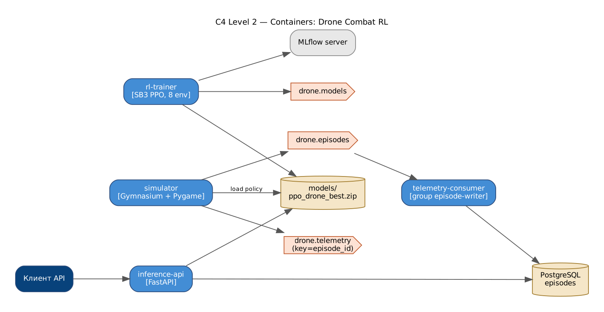
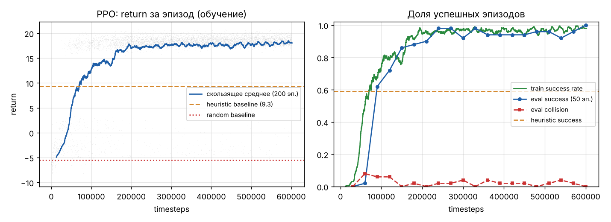

# Drone Combat RL — агент боевого дрона в 2D-симуляторе

Агент учится **двигаться к цели, облетать препятствия и выбирать момент атаки** (ограниченный боезапас, перезарядка).

**Стек:** Python · Gymnasium · PyTorch · Stable-Baselines3 (PPO) · Pygame · Kafka · MLflow · Docker



* **Среда** `DroneCombatEnv`: состояние 17 признаков (скорость, расстояние и угол до цели, состояние оружия, видимость, 9 лучей-дальномеров),
  5 действий (зависнуть, вперёд, поворот влево/вправо, огонь), сценарии open / forest / corridor / mixed.
* **Награда:** +0.05·прогресс к цели, −0.005 за шаг, +3 попадание, +10 уничтожение, −0.3 промах, −5 столкновение, −2 пустой боезапас.
* **Алгоритм:** PPO, 600k шагов, 8 сред, MLP 128×128 (обучение ~4 мин на CPU), логирование в MLflow.

Паттерны: **State** (оружие Ready/Reloading/Empty), **Command** (действия дрона), **Strategy** (политики random/heuristic/PPO),
**Observer** (телеметрия → Kafka/статистика), **Factory** (сценарии карт).

## Результаты (300 эпизодов на сценарий, одинаковые seed)

| Сценарий | Random | Heuristic | **PPO** |
|---|---|---|---|
| open | 0.3% | 100.0% | **100.0%** |
| forest | 0.0% | 49.7% | **96.0%** |
| corridor | 0.0% | 40.0% | **99.7%** |
| mixed | 0.0% | 59.0% | **97.7%** |



## Запуск

```bash
docker compose up -d --build                     # inference-api, simulator, telemetry-consumer, kafka, postgres, mlflow
docker compose --profile train run --rm trainer  # переобучить PPO
# Swagger: http://localhost:8000/docs, MLflow: http://localhost:5000

pip install -r requirements.txt
python -m services.trainer.train --timesteps 600000
python scripts/evaluate_and_plot.py
pytest -q
```

## API

| Метод | Путь | Описание |
|---|---|---|
| POST | /v1/act | действие политики по наблюдению |
| POST | /v1/episodes/run | прогнать эпизод (опционально PNG-кадр) |
| GET | /v1/policies | политики, сценарии, действия |
| GET | /v1/stats | статистика эпизодов из PostgreSQL |


## Демонстрация: Docker, e2e-тесты, нагрузка, Grafana

```powershell
docker compose build                                               # один раз
powershell -ExecutionPolicy Bypass -File scripts\demo.ps1 -SkipBuild  # Linux/macOS: ./scripts/demo.sh
```

Скрипт поднимает стек, ждёт healthcheck, сохраняет в `evidence/` список контейнеров, состав docker-сети,
топики Kafka, запускает **e2e-тесты из контейнера внутри сети** (`docker compose --profile e2e run --rm e2e`),
**нагрузочный тест k6** (`docker compose --profile load run --rm k6`) с выводом метрик в Prometheus,
снимает `docker stats` во время нагрузки, lag consumer groups и логи.

* Grafana: http://localhost:3000 — дашборд «overview»: k6 (RPS, латентность, ошибки) → API (RPS по эндпоинтам, p50/p95/p99, 4xx/5xx)
  → Kafka (поток по топикам, обработка по consumer group, **consumer lag**, время обработки, ретраи/DLQ, реплики воркеров) → доменные метрики.
* Prometheus: http://localhost:9090

Подробная инструкция с установкой Docker Desktop и записью видео — в `ДЕМО_ИНСТРУКЦИЯ.md` (корень архива).

## Автор

Царьков Артём — проект выполнен индивидуально (архитектура, код, обучение моделей, тесты, отчёт).
Отчёт по проекту (Word/PDF) — в папке [`report/`](report/).
